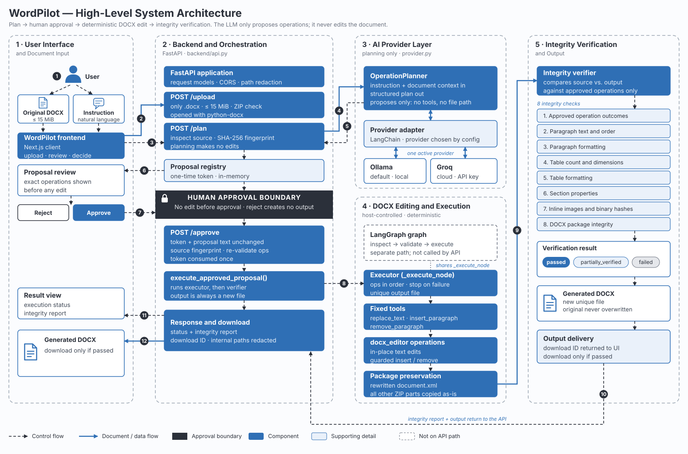

# WordPilot

WordPilot is a controlled DOCX editing prototype. A backend inspects an uploaded `.docx`, asks a configured language model for a typed edit proposal, requires human approval, applies supported edits through fixed Python tools, and reports structural integrity checks. The original file is not overwritten. The Next.js frontend calls the FastAPI API; it does not parse or edit DOCX files.

See [the architecture and compliance evidence](docs/WORDPILOT_ARCHITECTURE.md) for the component map, workflow boundaries, supported DOCX structures, test evidence, limitations, and submission status.

## Architecture at a glance



See the [architecture report](docs/WORDPILOT_ARCHITECTURE.md) for the execution flow, DOCX integrity pipeline, and DevFlow lifecycle diagrams.

## Case Study Compliance

The approved FastAPI execution path invokes the compiled LangGraph workflow. Its nodes inspect and validate the approved request, run the fixed Python DOCX tools, verify output integrity, and finalize the result. Downloads are registered only after integrity verification passes. See [the architecture report](docs/WORDPILOT_ARCHITECTURE.md) for implementation details, test coverage, and the supported DOCX limits.

## Run locally

Install Python dependencies from the repository root:

```powershell
python -m pip install -r requirements.txt
```

### Groq — recommended demonstrated configuration

The demonstrated WordPilot execution used Groq with model `openai/gpt-oss-120b`. Groq avoids hosting a language model on the developer machine, but requires internet connectivity and a Groq API key. The instruction and inspected document text are sent to the selected provider. Availability, pricing, applicable data-processing terms, retention policies, and organizational security requirements should be assessed before use. The application does not establish a provider's data-handling terms.

Copy the root `.env.example` to the untracked root `.env`, replace the placeholder `GROQ_API_KEY`, and keep `WORDPILOT_LLM_PROVIDER=groq`:

```powershell
python -m uvicorn backend.api:app --host 127.0.0.1 --port 8000
```

### Ollama — optional local deployment

WordPilot retains support for Ollama. For patient or medical documents, local inference is preferable when the machine can host a sufficiently capable model and keep inference/logging local.
To select it, set `WORDPILOT_LLM_PROVIDER=ollama`, choose the model with `WORDPILOT_LLM_MODEL` (default `qwen2.5:7b`), and set `WORDPILOT_OLLAMA_BASE_URL` if the service is not at `http://localhost:11434`. Pull the selected model in Ollama before starting the API. Local inference can keep requests within organizational infrastructure when correctly deployed and configured, and avoids per-request third-party inference API charges; it still has hardware, electricity, hosting, and operational costs. It requires adequate CPU, RAM and/or GPU resources. Local model performance and deployment compatibility were not fully validated in this development environment because of hardware limitations.

Provider selection is explicit. The code defaults to Ollama only if `WORDPILOT_LLM_PROVIDER` is unset; it does not automatically fall back between providers. The example configuration selects Groq, so a missing Groq key causes provider setup to fail rather than switching to Ollama. See the [provider configuration details](docs/WORDPILOT_ARCHITECTURE.md#provider-configuration-and-setup).

In another terminal:

```powershell
cd frontend
npm ci
Copy-Item .env.example .env.local
npm run dev
```

The sample workflow artifacts are [`therapist_session_notes.docx`](therapist_session_notes.docx) (input), [`therapist_session_notes_instruction.txt`](therapist_session_notes_instruction.txt) (instruction), and [`therapist_session_notes-verified.docx`](therapist_session_notes-verified.docx) (generated output). The output has passed the supported automated integrity checks and was manually inspected by the project author.

To reproduce the workflow in the app, upload the input, enter the instruction, review the proposed operations, and explicitly approve them. The supplied sample is fictional and is not a clinical template.

The API stores uploads and generated files under `uploads/` and `generated-documents/` and keeps active proposal/download registries in process memory. A single API process is required for a multi-step session; these stores are not durable or suitable for a serverless multi-invocation workflow. The frontend can be deployed separately; backend deployment needs durable shared storage and state before the full flow is reliable on Vercel.

## Checks

Backend tests: `python -m pytest -q`. Frontend checks, run from `frontend/`: `npm run typecheck` and `npm run build`.

## DevFlow is separate

`dev_workflow/` is optional development-time tooling that orchestrates Codex CLI for software development tasks. It is separate from WordPilot's delivered runtime, does not process WordPilot end-user instructions, and does not use the Ollama or Groq document providers. It requires Git, the repository's Python dependencies, and an independently installed and authenticated Codex CLI. The validated Windows setup and exact preflight-first menu sequence are in the [DevFlow CTO demo guide](docs/DEVFLOW_CTO_DEMO.md). Start with Python 3.12; `pyproject.toml` declares `>=3.12,<3.13`. Only the documented Windows CMD setup with Python 3.12.10 and the `elevated` Codex sandbox configuration has prior live execution evidence. Other operating systems and sandbox configurations are not established by that run. See the [DevFlow lifecycle and limitations](dev_workflow/VERIFICATION_LIFECYCLE.md) and the [documentation audit](docs/DEVFLOW_DOCUMENTATION_AUDIT.md).
