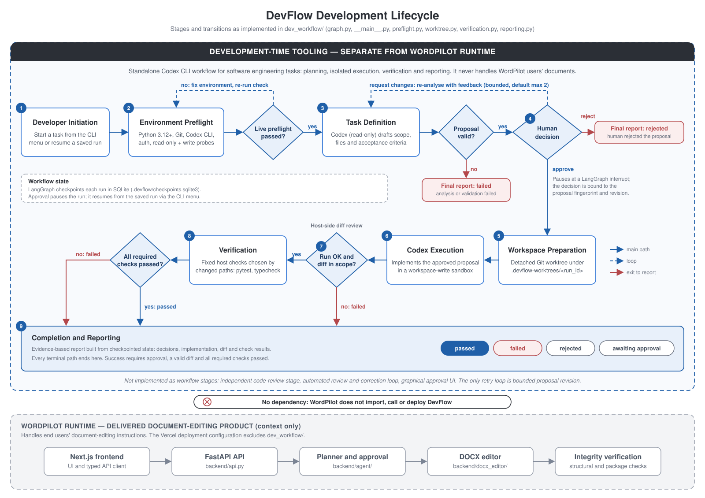

# CTO demo: DevFlow Python source generation

This guide describes the configured Windows workflow and a proposed reusable demonstration task. The previously validated execution used `calculate_square(number)` in an isolated worktree. The `average.py` / `test_average.py` task below is a future demonstration example; there is no prior execution evidence for it.



## Windows prerequisites

- Windows 10/11, Git for Windows, Python 3.12, and the project dependencies from `requirements.txt`.
- Node.js/npm compatible with the project's Next.js 15 dependency (Node.js 18.18 or newer) when demonstrating frontend changes.
- A trusted clone where Git can create `.devflow-worktrees/` under the repository.
- Codex CLI installed independently and authenticated with an allowed account or credential. DevFlow neither installs Codex nor provides or installs Codex credentials.
- A Codex Windows sandbox backend allowed by local or managed policy. `DEVFLOW_WINDOWS_SANDBOX` was configured as `elevated` for the demonstrated setup. DevFlow does not change policy or retry with weaker settings.

## Windows setup (Command Prompt)

Open **Command Prompt (CMD)** and run the demonstrated commands:

```bat
cd /d C:\Users\rayen\Desktop\wordpilot-ai

set DEVFLOW_WINDOWS_SANDBOX=elevated
set CODEX_CLI_PATH=%USERPROFILE%\.vscode\extensions\openai.chatgpt-26.1111.21308-win32-x64\bin\windows-x86_64\codex.exe

if exist "%CODEX_CLI_PATH%" (echo Codex CLI found) else (echo Codex CLI NOT found)

py -3.12 -m dev_workflow
```

`DEVFLOW_WINDOWS_SANDBOX` selects the Windows sandbox backend; `elevated` is the value configured for this validated workflow. `CODEX_CLI_PATH` points to the Codex executable installed through the VS Code extension. The extension-version directory can differ between installations, so adjust that path if needed. `CODEX_CLI_PATH` is optional when Codex is available through `PATH`. In CMD, `set` variables apply only to the current terminal session. Python 3.12.10 was the version used during validation.

The commands above launch DevFlow; they do not install Python dependencies or Codex. Install project dependencies and the Codex CLI separately as needed, and authenticate Codex independently before using the workflow.

## Required menu sequence

### Step 1 — Option 1: Check environment

Choose **1. Check environment** before creating a task. The previously successful preflight checked Python and Git availability, Codex CLI availability, dependencies and project configuration, Codex authentication, read-only execution, workspace-write execution in a disposable worktree, host-side marker and diff validation, and cleanup of the disposable preflight worktree. That preflight reported:

```text
Overall: passed
```

The live Codex checks verify authentication, a bounded read-only repository observation, and workspace-write capability. For workspace-write, DevFlow creates a disposable worktree, asks Codex to create a unique marker, validates the marker and complete host-collected diff, saves evidence, then removes the worktree. Cleanup is part of passing the preflight.

If preflight fails, do not proceed to implementation. Resolve the issue reported by option 1, then run option 1 again and confirm it passes. The CLI blocks option 2 unless the current session has a successful preflight.

### Step 2 — Option 2: Start a new task

Only after option 1 passes, choose **2. Start a new task** and enter the task description. Task entry is multiline: after typing the full description, type `END` by itself on a new line and press Enter. For a reusable CTO demonstration, use this example:

```text
Create average.py with an average(numbers) function that returns the arithmetic mean for a non-empty sequence and raises ValueError for an empty sequence. Add test_average.py pytest tests for positive values, negative values, and the empty sequence.
END
```

This average task is proposed demo content and has not been established as executed or passed. The prior verified task was `calculate_square(number)` in an isolated worktree.

Codex first analyzes the task and returns a structured proposal. Review its summary, requirements, expected files, included and excluded scope, risks, and acceptance criteria. At the human decision prompt, choose **1** to approve, **2** to reject, or **3** to request bounded proposal changes. Approval is bound to the exact proposal fingerprint and revision. Codex does not start implementation before explicit human approval. Rejection records a report without creating an implementation worktree; requesting changes returns the revised proposal for review. Implementation begins only after approval, in a detached worktree.

## Detached worktree and diff review

After approval, DevFlow creates a detached Git worktree under `.devflow-worktrees/<RUN_ID>` and runs implementation there, keeping the main checkout separate. The host collects the complete diff, including untracked files, and validates it against the approved proposal's file scope and expected actions. Host-collected diff validation is authoritative; model instructions alone do not enforce scope.

The final report identifies the worktree path, changed files, diff validation status, implementation result, verification checks and their statuses, failures, and overall status. Inspect the registered worktree and files using CMD, substituting the reported run ID:

```bat
git worktree list
git -C .devflow-worktrees/<RUN_ID> status --short
git -C .devflow-worktrees/<RUN_ID> diff --no-ext-diff --no-color HEAD
type .devflow-worktrees/<RUN_ID>/average.py
type .devflow-worktrees/<RUN_ID>/test_average.py
```

Plain `git diff` does not show untracked files, but DevFlow's host diff report includes them. The workflow leaves the implementation worktree available for inspection. It does not commit, push, or merge changes into the main checkout.

## Checkpoint and resume

The CLI stores workflow checkpoints in `.devflow/checkpoints.sqlite3` (ignored by Git). The SQLite checkpointer preserves workflow state across restarts, including a pending human approval. If you close the terminal while approval is pending, relaunch DevFlow, run option 1 successfully, then choose **3. Review pending approval**. Choose **4. Resume an existing workflow** to select and resume a saved run. Do not remove or replace the SQLite file. The final report is printed and retained in checkpoint state.

## Change-selected verification

Verification uses fixed host-defined checks selected from the validated changed files; task or model output cannot choose commands. Python changes select:

```text
python -m pytest -q -p no:cacheprovider
```

The Python verification process sets `PYTHONDONTWRITEBYTECODE=1` so pytest cache and bytecode artifacts do not change the worktree identity. Files under `frontend/` select `npm run typecheck` from the `frontend` directory. A mixed Python and frontend diff selects both checks. Documentation-only changes run no unrelated suite. Other unclassified source/configuration changes retain the full configured host check set.

Known limitation for frontend tasks: `frontend/node_modules` is ignored and is not copied into detached Git worktrees. There is no dependency-install stage between implementation and verification, so installing frontend dependencies in the main checkout does not provision the detached worktree. On a fresh worktree, frontend typechecking may fail because dependencies are absent; the report must retain that failure and cannot describe the overall run as successful. The workflow does not weaken verification or add a package-install mechanism to hide this limitation.

## Windows troubleshooting

- If Git reports `dubious ownership`, ensure the clone belongs to the current Windows user. Do not broadly mark directories safe.
- If Codex is missing, correct `CODEX_CLI_PATH` or make `codex` available through `PATH`. If authentication fails, complete Codex sign-in independently, then rerun option 1.
- If implementation is rejected by Windows sandbox policy, inspect the installed Codex Windows sandbox backend and managed policy. Confirm `DEVFLOW_WINDOWS_SANDBOX` names a permitted, supported backend. DevFlow does not modify settings or retry with a bypass.
- If a check fails, inspect its bounded stdout/stderr in the workflow report and reproduce it from the registered worktree. Never describe a failed or `not_run` check as passing.
- To reject a proposal, choose **2. Reject** at the proposal decision prompt; do not edit SQLite approval state manually.
