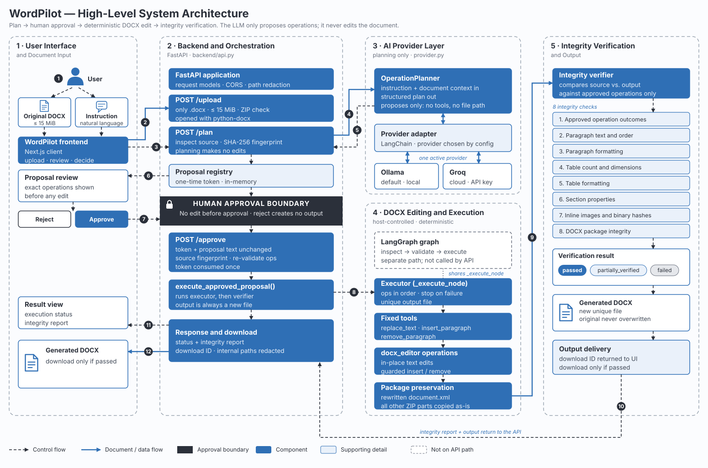
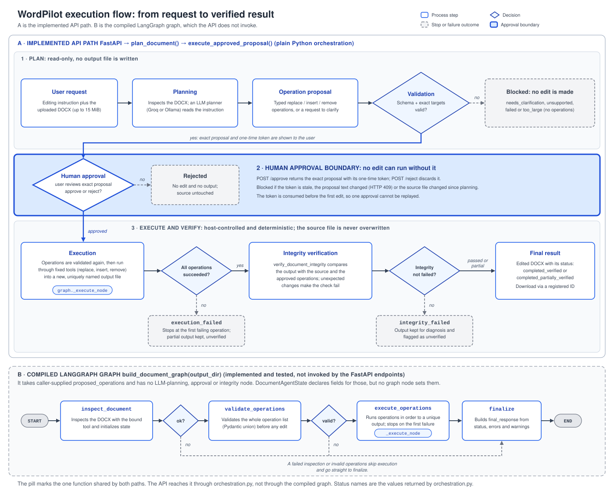
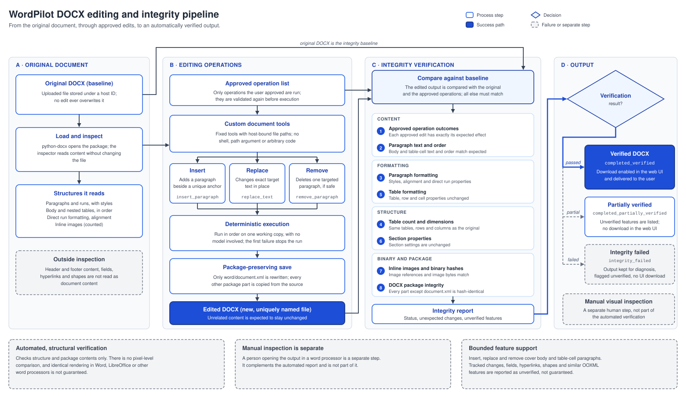
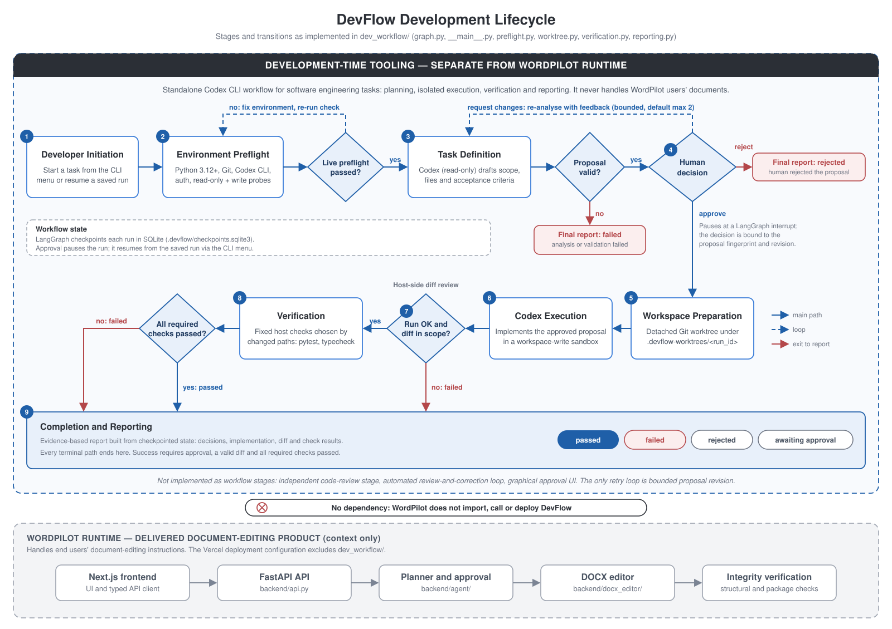

# WordPilot architecture and compliance evidence

## Audit basis and result

**CASE STUDY RESULT: REQUIREMENTS MET.**

The behavioral requirement source in this repository is [`therapist_session_notes_instruction.txt`](../therapist_session_notes_instruction.txt), applied to [`therapist_session_notes.docx`](../therapist_session_notes.docx). It asks for one paragraph to be inserted after the paragraph containing a specified sentence, that sentence to be replaced, and all other content and formatting to be preserved. The document is a fictional software demonstration fixture; it is not a clinical template.

### Repository map

| Path | Role |
|---|---|
| `backend/api.py`, `backend/agent/`, `backend/docx_editor/` | Delivered product API, planning/approval logic, custom tools, and DOCX operations. |
| `frontend/src/` | Next.js App Router UI and typed API client. |
| `tests/` | Synthetic DOCX, API, planner, orchestration, graph, and DevFlow regression tests. |
| `scripts/` | Provider integration scripts and API/DevFlow diagnostics. |
| `dev_workflow/` | Optional, separate Codex-based development workflow. |
| `docs/` | CTO demonstration guide and this architecture/compliance report. |
| `therapist_session_notes.docx`, `therapist_session_notes_instruction.txt`, `therapist_session_notes-verified.docx` | Supplied sample input, requested edit instructions, and generated result manually checked by the project author. |
| `uploads/`, `generated-documents/` | Local runtime data directories; their contents are not committed sample deliverables. |
| Root/frontend manifests and deployment files | Python dependencies, Next.js package lock/configuration, Vercel settings, and environment examples. |

The repository contains the requested editing workflow, synthetic regression coverage, and a completed website execution on the supplied sample. Two requested operations completed. The website displayed **“Integrity verified — passed”**; all supported integrity checks passed, with no unexpected differences or unverified features reported. The project author also manually inspected the generated output. The detailed verifier scope and broader technical limits are separated below.

In the compliance matrix, **VERIFIED** means the supplied implementation and execution evidence establish the stated case-study requirement. General OOXML and renderer limitations are documented separately and do not downgrade the demonstrated sample result.

## Runtime architecture

**Caption — WordPilot runtime components and host-controlled document boundary.**

*Figure 1. WordPilot runtime components, approval boundary, and verified DOCX delivery. The API uses the planner and deterministic executor directly; the separately compiled LangGraph workflow is shown as an alternate operation path and is not called by the HTTP API.*

The delivered product runtime is the FastAPI application in [`backend/api.py`](../backend/api.py), the planner and orchestration in [`backend/agent/`](../backend/agent/), the DOCX inspection/editor/integrity modules in [`backend/docx_editor/`](../backend/docx_editor/), and the Next.js client in [`frontend/src/`](../frontend/src/). The browser sends instructions and displays proposals/results; document parsing and edits stay on the backend. The API chooses upload and output paths, keeps internal paths out of public proposals, and exposes downloads only through registered IDs.

The runtime sequence is:

1. `POST /api/documents/upload` accepts `.docx` up to 15 MiB, checks ZIP package markers and CRC, opens it with `python-docx`, then stores it under a host-generated ID.
2. `POST /api/documents/{id}/plan` inspects the source and passes an ordered, compact document context plus the instruction to the selected provider. The LLM returns a `PlanningResult`; local Pydantic validation and exact-target checks reject malformed, missing, or ambiguous operations. Planning makes no edits.
3. The API retains the proposal and one-time token in process memory. The browser displays the exact proposed operations for a human decision.
4. `POST /api/documents/{id}/approve` checks the registered token, unchanged proposal, and source fingerprint; validates operations again; then calls the deterministic executor. It creates a unique output under `generated-documents/`, never overwriting the source.
5. The approved execution path runs integrity verification. A passing result can be downloaded through the registered download ID; partial or failed verification is surfaced as such.

This is not a streaming API and it does not render an editable/live Word preview. Proposal and download state is process-local; uploaded and generated files are local. Multi-step requests require the same live process, and deployment to ephemeral/serverless storage is not reliable without durable shared storage and state.

### LangGraph graph and routing

**Caption — Deterministic LangGraph operation path from inspection through final status.**

[`backend/agent/graph.py`](../backend/agent/graph.py) compiles `build_document_graph(output_directory)` with these nodes:

| Node | Behavior |
|---|---|
| `inspect_document` | Calls the bound inspection tool and initializes serializable result fields. |
| `validate_operations` | Validates the complete proposed operation list with a discriminated Pydantic union before any edit. |
| `execute_operations` | Executes validated operations sequentially using the fixed tool map; stops on first failure and preserves any partial output. |
| `finalize` | Builds a response from the resulting status, errors, and warnings. |

Edges: `START → inspect_document`; inspection routes to `validate_operations` or `finalize`; validation routes to `execute_operations` or `finalize`; execution goes to `finalize → END`. The output directory is host-selected and must already exist. State in [`backend/agent/state.py`](../backend/agent/state.py) uses paths and JSON-friendly values rather than live DOCX objects.

Important boundary: this compiled graph accepts operation dictionaries supplied by its caller. The LLM planner is a separate path, and the HTTP API joins planning/approval to the same deterministic `_execute_node` executor without invoking `build_document_graph`. Do not describe the API as one LLM-tool-calling LangGraph agent loop.

## Custom document tools and operation schemas

[`backend/agent/tools.py`](../backend/agent/tools.py) creates four fixed LangChain tools: `inspect_document`, `replace_text`, `insert_paragraph`, and `remove_paragraph`. The source and optional output paths are selected by host code; tool schemas do not expose paths, shell commands, arbitrary functions, or general-purpose code execution. The three edit tools delegate to the existing `backend/docx_editor` operations. Schemas in [`backend/operation_schemas.py`](../backend/operation_schemas.py) forbid extra fields and constrain operation type, required text, insertion position, and optional explicit locations.

`OperationPlanner` proposes operations only. It has no document path and invokes no editing tools. The system instruction treats document text as untrusted, allows only replace/insert/remove operations, and returns clarification for absent or ambiguous targets. Formatting-only requests are unsupported. This is a structured planner plus deterministic tools, not model-directed arbitrary execution.

## DOCX reading, editing, serialization, and verification

**Caption — DOCX package parts and structural checks around an approved body edit.**

### Read and edit behavior

[`inspection.py`](../backend/docx_editor/inspection.py) uses `python-docx` to inspect paragraphs and runs, body/table block order, nested tables and cell paragraphs, styles, alignment, direct run properties, and inline image count. Its planner projection preserves ordered paragraph/table/cell nesting. It does not inspect header/footer contents or every Word feature.

[`replacement.py`](../backend/docx_editor/replacement.py) changes `w:t` text nodes within contiguous safe text-only run sequences. Run and paragraph XML remain in place. A replacement spanning runs is placed in the first matched run, inheriting its formatting. Drawings, fields, breaks, and other non-text run XML are boundaries. It searches body and nested table-cell paragraphs.

[`paragraph_operations.py`](../backend/docx_editor/paragraph_operations.py) inserts before/after a uniquely matched exact paragraph (or explicit location), inheriting its style unless one is supplied. Removal is guarded: it rejects headings/titles, sole paragraphs in a location, and paragraphs with non-text XML. Operations can target body paragraphs or table-cell paragraphs through validated index tuples.

[`package_preservation.py`](../backend/docx_editor/package_preservation.py) asks `python-docx` to serialize the edited document, then writes a replacement package containing that serialized `word/document.xml` and the original bytes for every other ZIP member. It requires the package component names to match and atomically replaces the destination. This is a preservation mechanism for the current operation model, not a guarantee that all arbitrary OOXML semantics survive a `python-docx` load/save cycle.

### Automated integrity verification

[`integrity.py`](../backend/docx_editor/integrity.py) simulates the approved operations against an in-memory structural snapshot and compares the output. It checks ordered body and nested table-cell text, paragraph/table order, paragraph style/alignment and direct properties, run properties (including other direct run XML), table dimensions and table/row/cell properties, section properties, inline image references and bytes, plus hashes of all decompressed package parts other than `word/document.xml`. It limits package scanning to 10,000 ZIP entries, 64 MiB per component, and 256 MiB total uncompressed.

For the supplied sample run, the website displayed **“Integrity verified — passed.”** All supported integrity checks passed; the report contained no unexpected differences and no unverified features. The project author also manually inspected the generated output. This is sample-specific verification evidence and does not assert universal OOXML or rendering compatibility.

## Technical Boundaries and Future Improvements

The implementation supports a bounded set of DOCX editing and verification features. Automated checks cover the supported structures and properties described above; they establish structural and package-level integrity, not pixel-level visual equivalence. No pixel-level comparison is performed, and identical rendering across Microsoft Word, LibreOffice, or other applications is not guaranteed. Inline image placement and cropping are not compared. Header/footer parts and relationships are byte-compared as package components, but their meaning and layout are not rendered or semantically interpreted. Hyperlinks, numbering/list semantics, tracked changes, fields, bookmarks, content controls, text boxes/shapes, footnotes/endnotes, comments, embeddings, charts, diagrams, and other advanced OOXML behavior are not fully modeled; package-part equality alone does not prove semantic equivalence. Additional format-specific support and rendered comparisons can be added as future improvements. These broader boundaries do not invalidate the demonstrated case study workflow.

The following table describes general feature boundaries; it does not downgrade the verified result for the supplied case study sample.

### Feature handling summary

| Feature | Implementation/evidence | Technical boundary |
|---|---|---|
| Paragraph/run text and direct formatting | In-place `w:t` edits; formatting signatures; regression coverage | Supported properties are checked; no cross-renderer visual comparison is performed. |
| Tables and nested tables | Inspection, editing targets, block-order and table-property comparison | Dimensions, cells, and paragraph operations are covered; complex Word table semantics remain bounded. |
| Inline images | Inspector counts inline shapes; package copy preserves original media; verifier compares references and hashes | Placement/cropping are not compared; floating images/shapes are outside inspection. |
| Hyperlinks | Relationships and non-document package bytes are compared | Hyperlink target edits are unsupported and link semantics are not interpreted. |
| Headers and footers | Their package parts/relationships are preserved byte-for-byte and checked by package hashes | Contents/layout are not rendered or semantically inspected. |
| Numbering and lists | Unmodified package parts are copied and hashed | Numbering references and visual/list semantics are not separately interpreted. |
| Tracked changes, fields, controls, shapes, notes, embeddings | Some package/content features are detected as unverified; no comprehensive editor support | These advanced structures are not claimed as fully supported. |

## Provider configuration and setup

The runtime configuration in [`backend/agent/provider.py`](../backend/agent/provider.py) is authoritative. Groq is the recommended demonstrated configuration; Ollama remains an optional local integration. Provider selection is explicit and there is no automatic fallback:

| Setting | Runtime behavior when selected/omitted |
|---|---|
| `WORDPILOT_LLM_PROVIDER` | Defaults to `ollama` only when unset; accepted values are `ollama` and `groq`; unknown values fail. No automatic provider fallback. |
| Ollama model | `WORDPILOT_LLM_MODEL`, default `qwen2.5:7b`. |
| Ollama endpoint | `WORDPILOT_OLLAMA_BASE_URL`, default `http://localhost:11434`. |
| Groq model | `GROQ_MODEL`, default `openai/gpt-oss-120b`. |
| Groq credential | `GROQ_API_KEY` is required when Groq is selected. |
| Request timeout | `WORDPILOT_LLM_TIMEOUT_SECONDS`, default `30`; non-positive values fail. |

The root [`.env.example`](../.env.example) selects Groq and includes a placeholder `GROQ_API_KEY`; replace it with a valid backend-only key. This example selection is distinct from the code's Ollama default when the provider setting is absent. If Groq is selected without a key, provider setup fails; it does not switch to Ollama. To select Ollama, set `WORDPILOT_LLM_PROVIDER=ollama`; `WORDPILOT_LLM_MODEL` selects its model and defaults to `qwen2.5:7b`, while `WORDPILOT_OLLAMA_BASE_URL` defaults to `http://localhost:11434`.

**Demonstrated configuration: Groq.** Groq was selected for the demonstrated execution environment because the available development hardware was insufficient to host local language models with satisfactory performance. Groq requires an API key and internet connectivity; requests are processed by an external provider. Organizations should assess provider availability, pricing, applicable data-processing terms, retention policies, and security requirements for their use case. This repository does not establish Groq's current terms.

**Alternative configuration: Ollama.** The application retains its Ollama integration for organizations with sufficient local computational resources that prefer local inference. When correctly deployed and configured, local inference can keep requests within organizational infrastructure and reduce dependence on external inference APIs. It requires suitable CPU, RAM and/or GPU resources and incurs hardware, electricity, hosting, and operational costs. Local model performance and deployment compatibility were not fully validated in the development environment because of hardware limitations. Do not interpret provider unit tests, which use fakes, as live validation of either provider. The demonstrated website execution establishes the sample workflow using its configured provider, not equivalent validation of both providers.

## Compliance matrix for the supplied instruction

### Actual sample execution

- **Input:** [`therapist_session_notes.docx`](../therapist_session_notes.docx)
- **Instruction:** [`therapist_session_notes_instruction.txt`](../therapist_session_notes_instruction.txt)
- **Output:** [`therapist_session_notes-verified.docx`](../therapist_session_notes-verified.docx)
- **Execution result:** the website completed the two requested operations and displayed **“Integrity verified — passed.”** All supported integrity checks passed, with no unexpected differences and no unverified features reported.
- **Manual review:** the project author inspected the generated output.

| Requirement | Status | Evidence (source and exact tests) | Proves / does not prove / remaining risk |
|---|---|---|---|
| Turn the natural-language request into the requested insert and replace operations | **VERIFIED** | Website execution using the supplied instruction; `backend/agent/planner.py`, `backend/agent/orchestration.py`; `tests/test_agent_planner.py::test_planner_returns_valid_operations`, `tests/test_agent_orchestration.py::test_planning_returns_approval_proposal_without_output`, `tests/test_agent_orchestration.py::test_approval_executes_and_preserves_original` | The supplied task completed as two requested operations in the website workflow. Regression tests additionally cover structured planning, approval, and execution. |
| Insert the new paragraph after the paragraph containing the target sentence | **VERIFIED** | [`therapist_session_notes-verified.docx`](../therapist_session_notes-verified.docx); `backend/operation_schemas.py`, `backend/agent/planner.py`, `backend/docx_editor/paragraph_operations.py`; `tests/test_docx_editor.py::test_insert_after_preserves_original_paragraph`, `tests/test_docx_editor.py::test_insert_inside_table_cell_when_target_is_unique` | The generated output contains the requested paragraph immediately after the target paragraph; the website's integrity result passed. Regression tests cover insertion around exact anchors. |
| Replace the exact current sentence with the supplied replacement sentence | **VERIFIED** | [`therapist_session_notes-verified.docx`](../therapist_session_notes-verified.docx); `backend/docx_editor/replacement.py`, `backend/agent/planner.py`; `tests/test_docx_editor.py::test_cross_run_preserves_formatting_and_surrounding_text`, `tests/test_docx_editor.py::test_replaces_multiple_occurrences_in_one_paragraph`, `tests/test_docx_integrity.py::test_approved_replacement_across_adjacent_runs_preserves_formatting` | The generated output contains the requested replacement; the website's integrity result passed. Regression tests cover exact replacement, including across safe adjacent runs. |
| Preserve all other supported content and formatting | **VERIFIED** | Website integrity result for the supplied source/output; `backend/docx_editor/package_preservation.py`, `backend/docx_editor/integrity.py`; `tests/test_docx_editor.py::test_package_parts_preserved_or_modified_as_expected`, `tests/test_docx_editor.py::test_image_and_structure_survive_replacement`, `tests/test_docx_integrity.py::test_unapproved_formatting_change_fails`, `tests/test_docx_integrity.py::test_unrelated_table_cell_change_fails`, `tests/test_docx_integrity.py::test_changed_unrelated_package_part_fails` | All supported checks passed with no unexpected differences and no unverified features for this sample. Regression tests cover preservation and detection on synthetic fixtures. Broad OOXML and cross-renderer limits are separate below. |
| Provide the edited sample DOCX deliverable | **VERIFIED** | [`therapist_session_notes.docx`](../therapist_session_notes.docx), [`therapist_session_notes_instruction.txt`](../therapist_session_notes_instruction.txt), and [`therapist_session_notes-verified.docx`](../therapist_session_notes-verified.docx) | The input, instruction, and generated output are present and linked. The website reported a passing integrity result, and the project author manually inspected the output. |

## Test and fixture evidence map

The test functions below are evidence of regression scenarios in source; this documentation update did not rerun them. No test fixture creates the supplied therapist-session sample: [`tests/conftest.py`](../tests/conftest.py) creates a separate synthetic document with a title paragraph, formatted text runs, a table, and an optional one-pixel inline image.

| Area | Test files and representative exact tests |
|---|---|
| Tool/schema boundary | [`tests/test_agent_foundation.py`](../tests/test_agent_foundation.py): `test_tools_are_fixed_and_do_not_expose_paths`, `test_tool_argument_validation_rejects_empty_target`, `test_tool_adapters_call_existing_document_operations`, `test_tool_rejects_unrecognized_arguments`, `test_agent_state_is_json_serializable`. |
| LangGraph execution | [`tests/test_agent_graph.py`](../tests/test_agent_graph.py): `test_successful_inspection_and_one_replacement`, `test_multiple_operations_execute_sequentially`, `test_invalid_operation_list_prevents_all_edits`, `test_middle_failure_returns_partial_output_and_stops`, `test_graph_state_is_json_serializable`. |
| Planning and approval | [`tests/test_agent_planner.py`](../tests/test_agent_planner.py): `test_planner_returns_valid_operations`, `test_repeated_target_is_converted_to_host_clarification`, `test_invalid_structured_or_malformed_response_is_rejected`, `test_provider_selection_and_model_configuration`; [`tests/test_agent_orchestration.py`](../tests/test_agent_orchestration.py): `test_approval_executes_and_preserves_original`, `test_rejection_does_not_create_output`, `test_modified_security_relevant_proposal_fields_are_rejected`, `test_partial_verification_returns_completed_partially_verified`. |
| Editing and package preservation | [`tests/test_docx_editor.py`](../tests/test_docx_editor.py): `test_cross_run_preserves_formatting_and_surrounding_text`, `test_table_cell_replacement_preserves_other_content`, `test_image_and_structure_survive_replacement`, `test_package_parts_preserved_or_modified_as_expected`, `test_insert_after_preserves_original_paragraph`, `test_remove_paragraph_and_preserve_neighbors_and_image`. |
| Integrity verifier | [`tests/test_docx_integrity.py`](../tests/test_docx_integrity.py): `test_approved_replacement_across_adjacent_runs_preserves_formatting`, `test_unapproved_formatting_change_fails`, `test_inline_image_loss_fails`, `test_changed_image_relationship_is_detected`, `test_changed_unrelated_package_part_fails`, `test_harmless_zip_recompression_and_entry_order_pass`, `test_image_layout_scope_is_reported_as_partial`, `test_nested_table_cells_are_compared`, `test_unchanged_headers_and_footers_do_not_downgrade_body_edit`. |
| HTTP boundary | [`tests/test_api.py`](../tests/test_api.py): `test_upload_valid_docx_and_reject_bad_or_large`, `test_plan_and_approve_validates_exact_proposal`, `test_approval_rejects_modified_server_upload_and_consumes_token`, `test_download_returns_only_registered_output`, `test_unknown_and_path_traversal_ids_are_404`. |

## Functional Editing Test Coverage

The functional editing regression tests use separate temporary DOCX test documents created for testing, rather than relying only on the final therapist-session sample. [`tests/conftest.py`](../tests/conftest.py) defines `make_docx`, which creates a formatted title paragraph with multiple runs, an unrelated paragraph, a table cell, and optionally an inline image. The cases below are represented by named test functions with assertions in the repository. This documentation update does not claim a new pytest run or invent a test count; the actual end-to-end website sample run is recorded separately below.

| Operation | Scenarios covered by existing test cases | Exact evidence |
|---|---|---|
| Insertion | Insert `Inserted` before a formatted paragraph, `Following` after an exact body anchor, and `Cell addition` after a table-cell paragraph; apply `Heading 2` style to one inserted paragraph; select a duplicate anchor by explicit location. | `tests/test_docx_editor.py::test_insert_before_preserves_original_paragraph`, `test_insert_after_preserves_original_paragraph`, `test_insert_inside_table_cell_when_target_is_unique`, `test_insert_uses_requested_style`, `test_insert_duplicate_target_at_explicit_location`; `tests/test_docx_integrity.py::test_approved_insert_before_and_after_are_expected`, `test_approved_insertion_inside_table_cell_is_expected`. |
| Replacement | Replace `old text` with `new` across formatted runs; replace `target` with `result` in a table cell; replace three `cat` occurrences with `dog`; replace text in nested tables and in sequential multi-operation workflows while retaining surrounding content. | `tests/test_docx_editor.py::test_cross_run_preserves_formatting_and_surrounding_text`, `test_table_cell_replacement_preserves_other_content`, `test_replaces_multiple_occurrences_in_one_paragraph`, `test_replaces_text_in_nested_table`; `tests/test_agent_graph.py::test_multiple_operations_execute_sequentially`; `tests/test_docx_integrity.py::test_approved_replacement_across_adjacent_runs_preserves_formatting`. |
| Deletion | Remove `Unrelated paragraph` while preserving its neighbors and an unrelated image; remove `Cell target value` by table-cell location while retaining another cell paragraph; select one duplicate `Repeated` paragraph by explicit location; reject unsafe heading/image deletion. | `tests/test_docx_editor.py::test_remove_paragraph_and_preserve_neighbors_and_image`, `test_remove_paragraph_in_specified_table_cell`, `test_remove_duplicate_by_explicit_body_location`, `test_remove_refuses_heading`, `test_remove_refuses_paragraph_with_image`; `tests/test_docx_integrity.py::test_approved_removal_is_expected`, `test_approved_removal_from_table_cell_is_expected`, `test_explicit_removal_location_resolves_duplicate_targets`. |

The insertion operation accepts a unique exact-paragraph anchor, so a heading can serve as an anchor. Existing tests cover generic body/table anchors and a single inserted paragraph styled `Heading 2`; they do not explicitly test inserting under a particular existing heading or inserting a complete heading-plus-body section as a pair. Those extra scenarios are not described as completed tests. The actual case-study instruction and two-operation sample are covered by the final website execution below.

## Final End-to-End Sample Execution

The three sample artifacts are [`therapist_session_notes.docx`](../therapist_session_notes.docx) (input; 25,830 bytes, 49 body paragraphs, 6 top-level tables, no media parts), [`therapist_session_notes_instruction.txt`](../therapist_session_notes_instruction.txt) (exact instruction), and [`therapist_session_notes-verified.docx`](../therapist_session_notes-verified.docx) (generated output; 50 body paragraphs, 6 top-level tables). The original sample and its exact instruction were submitted through the WordPilot website. Two requested operations completed, and the website displayed **“Integrity verified — passed.”** All supported integrity checks passed; no unexpected differences or unverified features were detected by the verifier. The project author manually inspected the generated output.

The website reported these eight integrity checks:

1. Approved operation outcomes (`approved_operation_outcomes`).
2. Paragraph text and order (`paragraph_text_and_order`).
3. Paragraph formatting (`paragraph_formatting`).
4. Table count and dimensions (`table_count_and_dimensions`).
5. Table formatting (`table_formatting`).
6. Section properties (`section_properties`).
7. Inline images and binary hashes (`inline_images`).
8. DOCX package integrity (`docx_package`).

### Manual Visual Inspection

The project author opened and visually inspected `therapist_session_notes-verified.docx`. The visual presentation outside the requested edits remained intact, and the requested changes appeared in their intended locations without visibly disrupting the surrounding document. This manual inspection complements the automated structural and package-level integrity verification; it is not a pixel-level comparison or a guarantee of identical rendering across applications.

## Unsupported or unverified README claims

The README keeps the user-facing overview short and links here for technical evidence. The following qualifications govern evaluation claims:

- “Completed and verified” means the verifier's supported structural checks passed; it does not mean Word rendering is equivalent or unsupported OOXML semantics are preserved.
- `.env.example` selects the demonstrated Groq configuration; the code defaults to Ollama only when `WORDPILOT_LLM_PROVIDER` is unset. Selection is explicit and no automatic fallback is implemented. README and provider setup above describe this distinction.
- Provider unit tests are mocked. They do not establish live Groq/Ollama calls, model availability, network behavior, latency, or equivalent provider validation.
- Regression tests use synthetic fixtures, while the supplied input/instruction/output are covered by the website execution and passing integrity result documented above.
- Vercel configuration can build/route the services, but ephemeral local storage and in-memory registries do not support reliable multi-step workflows across serverless instances.
- DevFlow documentation describes implemented workflow paths and tests; it must not be conflated with WordPilot's delivered DOCX runtime or represented as an independently reviewed/repairing workflow.

## DevFlow: separate development workflow

**Caption — DevFlow's proposal approval and detached-worktree lifecycle, separate from WordPilot document editing.**

[`dev_workflow/`](../dev_workflow/) is an optional Codex CLI development orchestrator, not a document-editing provider or dependency. Its LangGraph stages cover read-only analysis, strict proposal validation, fingerprint-bound human approval/revision, detached worktree implementation, host-side diff validation, fixed host-selected verification, and evidence-based reporting. This is an initial version built within the available time. It can be improved with a dedicated independent review stage, an automated correction loop, and a richer approval experience; those enhancements were left for future work. Its verification/review limits are detailed in [`dev_workflow/VERIFICATION_LIFECYCLE.md`](../dev_workflow/VERIFICATION_LIFECYCLE.md); the CTO demo is in [`docs/DEVFLOW_CTO_DEMO.md`](DEVFLOW_CTO_DEMO.md).

Relevant implementation files: `dev_workflow/graph.py`, `schemas.py`, `state.py`, `codex_cli.py`, `worktree.py`, `verification.py`, `checkpointing.py`, `reporting.py`, `preflight.py`, and `__main__.py`. Relevant tests include `tests/test_dev_workflow_graph.py::test_approval_is_required_before_isolated_implementation`, `tests/test_dev_workflow_checkpointing.py::test_graph_requires_an_explicit_checkpointer`, `tests/test_dev_workflow_checkpointing.py::test_sqlite_checkpoint_survives_closed_saver_and_resumes_same_interrupt`, `tests/test_dev_workflow_verification.py::test_checks_are_selected_from_host_changed_paths`, `tests/test_dev_workflow_reporting.py::test_success_requires_all_required_evidence_and_preserves_approval`, and `tests/test_dev_workflow_codex_cli.py::test_success_uses_read_only_cli_stdin_and_explicit_working_directory`. These are primarily adapter/fake-driven tests; they do not prove a live Codex account or host sandbox is available. The checkout had pre-existing uncommitted changes in `dev_workflow/preflight.py` and `tests/test_dev_workflow_preflight.py` during this audit; this documentation change does not assess or alter those edits.

## Highest-priority gaps

1. Add a repeatable CI integration test for the supplied workflow so future changes can guard the sample behavior.
2. Add a rendered visual comparison in Word-compatible rendering software; keep structural/package checks distinct from visual validation.
3. Define the supported OOXML feature boundary more precisely and test representative hyperlink, numbering, header/footer, tracked-change, field, and shape documents before claiming those structures are safe.
4. Validate Ollama performance and deployment compatibility on adequately provisioned hardware before making performance claims.
5. Before describing hosted multi-step use as production-ready, move files and workflow registries to durable shared services. Keep DevFlow review/repair capabilities described as absent until they exist.
